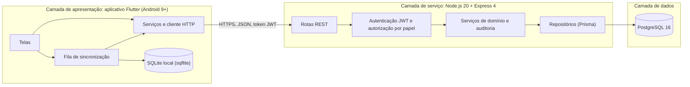

# EquiLog

## 1. Identificação

| | |
|---|---|
| Trabalho | Registro integrado de saúde, manejo, treinamento e desempenho de equinos atletas: desenvolvimento e avaliação de um protótipo de aplicação móvel para a modalidade de três tambores |
| Autor | Alysson Henrique Vasconcelos |
| Curso | Bacharelado em Ciência da Computação |
| Instituição | Universidade Paulista (UNIP), Polo Paraisópolis |
| Ano | 2026 |

Este repositório contém o protótipo acadêmico que acompanha o Trabalho de Curso.
**Não é um produto e não tem uso em produção.** Ele roda inteiramente na máquina de
quem avalia: não há servidor em nuvem, domínio público nem certificado emitido por
autoridade certificadora.

## 2. O que o sistema faz e o que não faz

O EquiLog registra, em uma linha do tempo única por animal, eventos de quatro
domínios: saúde, manejo, treinamento e competição. Proprietário, médico
veterinário, treinador e responsável pelo manejo acessam o mesmo animal, cada um
com as permissões do seu papel, e o servidor decide o que cada pessoa pode ler ou
registrar a cada requisição. O aplicativo continua registrando sem conexão e envia
os registros quando a rede volta. Quando a própria pessoa digita uma data de
retorno, o sistema gera um lembrete. Ele também exporta o histórico em PDF e mantém
uma trilha de auditoria.

O que o sistema **deliberadamente não faz** (RNF11):

- nenhuma inferência clínica: não interpreta sintomas, exames ou procedimentos;
- nenhuma recomendação de conduta: não sugere tratamento, dose, manejo ou treino;
- nenhuma predição de desempenho: não estima tempo, colocação ou aptidão.

Todo lembrete vem de uma data digitada por uma pessoa; o sistema não calcula
datas de reforço nem de retorno.

## 3. Arquitetura

O sistema tem três camadas: aplicação móvel, serviço REST e banco de dados
relacional.



O serviço e o banco rodam em contêineres Docker (`docker-compose.yml`). O
aplicativo roda no emulador Android e acessa o serviço pela máquina hospedeira.

## 4. Stack e versões verificadas

Versões obtidas no ambiente em que o projeto foi construído e validado
(`npm ls`, `flutter pub deps`, `docker version`, `SHOW server_version`).

| Componente | Versão |
|---|---|
| Node.js (hospedeiro e contêiner `node:20-bookworm-slim`) | 20.20.2 |
| npm | 10.8.2 |
| Express | 4.22.3 |
| Prisma e @prisma/client | 6.19.3 |
| PostgreSQL (imagem `postgres:16`) | 16.15 |
| bcrypt | 6.0.0 |
| jsonwebtoken | 9.0.3 |
| multer | 2.4.0 |
| pdfkit | 0.20.2 |
| Jest | 30.5.2 |
| supertest | 7.3.1 |
| Flutter / Dart | 3.47.7 / 3.13.5 |
| sqflite | 2.4.4+1 |
| http | 1.6.0 |
| flutter_secure_storage | 11.2.0 |
| flutter_local_notifications | 22.3.2 |
| connectivity_plus | 7.3.2 |
| Docker Engine / Docker Compose | 29.9.0 / 5.6.0 |
| JDK | 17.0.20.1 |
| Android Gradle Plugin / Gradle / Kotlin | 9.1.0 / 9.3.1 / 2.4.0 |

## 5. Pré-requisitos

| Ferramenta | Versão mínima | Para quê |
|---|---|---|
| Git | qualquer versão recente | clonar o repositório |
| Docker Engine com Compose v2 | Compose v2 (usa `name:` e `depends_on` com `condition`) | serviço e banco |
| Node.js | 20 LTS | migrações, seed, testes do serviço e scripts de massa de teste |
| Flutter | 3.47.7 (Dart 3.13.5, exigido pelo `pubspec.yaml`) | compilar e testar o aplicativo |
| JDK | 17 | compilação Android |
| Android SDK com Command-line Tools | plataforma 36, imagem de sistema API 28 | compilação e emulador |

Antes de compilar o aplicativo, `flutter doctor` não deve apontar pendências nas
seções Flutter e Android toolchain (as licenças do SDK são aceitas com
`flutter doctor --android-licenses`).

**Docker no Windows.** O projeto foi desenvolvido com Docker Engine instalado
dentro do WSL2 (Ubuntu 24.04), sem Docker Desktop. Com Docker Desktop, os comandos
deste README funcionam iguais. Com Docker Engine no WSL, rode os comandos
`docker compose` dentro do WSL, na pasta do repositório (por exemplo
`/mnt/c/...`), e configure o WSL conforme a seção 13 para que as portas fiquem
acessíveis em `127.0.0.1` no Windows.

As portas 3443 (HTTPS), 3080 (HTTP) e 5432 (PostgreSQL) precisam estar livres.

## 6. Instalação

Todos os comandos partem da raiz do repositório, salvo indicação.

1. Clone o repositório e entre na pasta:

   ```sh
   git clone https://github.com/Alysson212/equilog.git
   cd equilog
   ```

2. Crie os arquivos de variáveis de ambiente. O script copia `.env.example` para
   `.env` e `servico/.env.example` para `servico/.env`, com senha do banco e
   segredos JWT aleatórios (os arquivos `.env` não são versionados):

   ```sh
   node scripts/configurar-ambiente.js
   ```

3. Suba o banco e o serviço:

   ```sh
   docker compose up -d --build
   ```

   Na primeira subida, o contêiner do serviço gera o certificado autoassinado em
   `servico/certs/` (`servidor.crt` e `servidor.key`, válidos por 365 dias, para
   `localhost`, `127.0.0.1` e `10.0.2.2`), aplica as migrações e começa a atender.

4. Instale as dependências do serviço no hospedeiro, gere o cliente do Prisma e
   aplique a carga inicial (papéis, permissões e tipos de evento). O `npm ci` não
   gera o cliente sozinho; sem `prisma generate`, o seed falha:

   ```sh
   cd servico
   npm ci
   npx prisma generate
   npx prisma migrate deploy
   npx prisma db seed
   cd ..
   ```

5. Confira o serviço:

   ```sh
   curl -k https://127.0.0.1:3443/saude-servico
   curl -i http://127.0.0.1:3080/saude-servico
   ```

   O primeiro responde `{"situacao":"ativo"}`. O segundo responde
   `426 Upgrade Required`: o serviço recusa canal não cifrado (RNF02).

Para gerar o certificado de novo (por exemplo, depois de vencido):

```sh
docker compose exec servico sh scripts/gerar-certificado.sh -f
docker compose restart servico
```

## 7. Testes do serviço

A partir de `servico/`, com o banco no ar:

```sh
npm test
npm run test:cobertura
```

O primeiro roda a suíte de unidade e integração. O segundo roda a mesma suíte e
grava o relatório de cobertura em `servico/coverage/`.

Resultado obtido na validação por clone limpo (seção 14): **259 testes em 10
arquivos, todos aprovados**. Cobertura: 93,91% das instruções, 81,33% dos ramos,
97,7% das funções e 95,99% das linhas.

A suíte usa um banco exclusivo, `equilog_teste` (variável `DATABASE_URL_TESTE` em
`servico/.env`). Qualquer outro nome de banco é recusado, para que a base de
desenvolvimento nunca seja apagada por engano. Antes da suíte, as migrações e o
seed são aplicados nesse banco; antes de cada teste, os dados de uso são apagados.

## 8. Massa de teste

A partir da raiz do repositório, com o serviço no ar e a seção 6 concluída:

```sh
node dados-de-teste/reinicializar.js --confirmar
```

O script **apaga todos os dados de uso** da base de desenvolvimento e cria o estado
padronizado das sessões de avaliação: 2 animais, 30 eventos nos quatro domínios,
5 lembretes e um usuário por papel. Todos usam a senha `sessao-equilog-2026` (ou a
da variável `SENHA_SESSAO`). Ao final, ele lista os usuários e o código de
recuperação de senha de cada um:

| Papel | E-mail |
|---|---|
| Proprietário | `proprietario@sessao.equilog` |
| Veterinário | `veterinario@sessao.equilog` |
| Treinador | `treinador@sessao.equilog` |
| Manejo | `manejo@sessao.equilog` |

Para o caso de teste CT12 (desempenho da linha do tempo com 500 eventos, RNF05):

```sh
node dados-de-teste/carregar-ct12.js
node dados-de-teste/medir-ct12.js
```

O primeiro acrescenta 500 eventos ao animal "Estrela do Sul"; o segundo mede o
tempo de resposta da linha do tempo. Os scripts recusam bancos que não sejam
locais.

## 9. Aplicativo

### 9.1 Certificado de desenvolvimento

O aplicativo só confia no certificado autoassinado do serviço se ele estiver
empacotado no próprio aplicativo. Não existe desativação genérica da verificação
de certificado. Copie o certificado gerado na seção 6 para os recursos do
aplicativo:

```sh
cp servico/certs/servidor.crt aplicativo/assets/certificados/servidor.crt
```

No PowerShell, `cp` também funciona. Repita a cópia sempre que o certificado for
gerado de novo.

### 9.2 Testes do aplicativo

A partir de `aplicativo/`, com o serviço no ar:

```sh
flutter pub get
flutter test
```

Os testes de sincronização (CT09 a CT11) e de operações usam o **serviço real** em
`https://127.0.0.1:3443` (variável `EQUILOG_API_URL`), com o certificado lido de
`servico/certs/servidor.crt`. A única coisa simulada é a falta de rede no aparelho.
Esses testes criam usuários na base de desenvolvimento; depois deles, volte ao
estado padronizado com o comando da seção 8.

Resultado obtido na validação por clone limpo: **20 testes, todos aprovados**.

### 9.3 Emulador Android com API 28

O requisito mínimo é Android 9 (API 28). As ferramentas do Android SDK
normalmente não ficam no PATH, por isso os comandos abaixo usam o caminho completo
a partir da pasta do SDK (no Windows, `%LOCALAPPDATA%\Android\Sdk`; no Linux,
`~/Android/Sdk`; o caminho exato aparece em `flutter doctor -v`).

No PowerShell (Windows):

```powershell
$sdk = "$env:LOCALAPPDATA\Android\Sdk"
& "$sdk\cmdline-tools\latest\bin\sdkmanager.bat" "platform-tools" "emulator" "platforms/android-36" "system-images/android-28/google_apis/x86_64"
echo no | & "$sdk\cmdline-tools\latest\bin\avdmanager.bat" create avd -n equilog_api28 -k "system-images;android-28;google_apis;x86_64" -d pixel_4
flutter emulators --launch equilog_api28
```

No Linux ou macOS:

```sh
SDK="$HOME/Android/Sdk"
"$SDK/cmdline-tools/latest/bin/sdkmanager" "platform-tools" "emulator" "platforms/android-36" "system-images/android-28/google_apis/x86_64"
echo no | "$SDK/cmdline-tools/latest/bin/avdmanager" create avd -n equilog_api28 -k "system-images;android-28;google_apis;x86_64" -d pixel_4
flutter emulators --launch equilog_api28
```

O `sdkmanager` das Command-line Tools atuais (23.0) identifica pacotes com `/`;
versões antigas usam `;` (`system-images;android-28;google_apis;x86_64`). O
`avdmanager` aceita a forma com `;`. O `echo no` responde à pergunta sobre
perfil de hardware personalizado. Aguarde o emulador terminar de iniciar antes do
próximo passo (`flutter devices` deve listá-lo).

### 9.4 Compilar e executar

A partir de `aplicativo/`, com o emulador aberto e o serviço no ar:

```sh
flutter run
```

Para gerar o APK:

```sh
flutter build apk --release
```

O arquivo fica em `aplicativo/build/app/outputs/flutter-apk/app-release.apk` e é
assinado com a chave de depuração, o que basta para o emulador. Para instalar esse
APK no emulador aberto:

```sh
flutter install --release
```

Para entrar no aplicativo, use um dos usuários da seção 8.

O endereço padrão do serviço no aplicativo é `https://10.0.2.2:3443`: é assim que o
emulador Android enxerga a máquina hospedeira. Em aparelho físico na mesma rede,
compile com `--dart-define=API_URL=https://<ip-da-maquina>:3443` e gere o
certificado incluindo esse IP.

## 10. Endpoints

Todos sob HTTPS. A autorização é resolvida no servidor a cada requisição pela
tripla usuário, animal e papel vigente (seção 4 da especificação). "Todos os
papéis" significa qualquer pessoa com vínculo vigente com o animal. Nos endpoints
de evento, vale a permissão do domínio: saúde é registrada só pelo veterinário;
manejo, pelo proprietário e pelo manejo; treinamento e competição, pelo
proprietário e pelo treinador.

| # | Método | Caminho | Papéis autorizados | Requisito |
|---|---|---|---|---|
| 1 | POST | `/auth/login` | Público | RF02 |
| 2 | POST | `/auth/refresh` | Portador de token de renovação válido | RF03 |
| 3 | POST | `/auth/recuperar-senha` | Público, com o código de recuperação | RF01, RF02 (decisão 9.7) |
| 4 | POST | `/usuarios` | Público | RF01 |
| 5 | GET | `/animais` | Qualquer usuário autenticado (só animais com vínculo vigente) | RF08 |
| 6 | POST | `/animais` | Qualquer usuário autenticado, que se torna proprietário | RF04 |
| 7 | GET | `/animais/{id}` | Todos os papéis | RF08 |
| 8 | PATCH | `/animais/{id}` | Proprietário | RF05 |
| 9 | GET | `/animais/{id}/eventos` | Todos os papéis; só os domínios que o papel pode ler | RF13, RF14 |
| 10 | POST | `/animais/{id}/eventos` | Conforme o domínio (ver acima) | RF09 a RF12, RF17 |
| 11 | PATCH | `/eventos/{id}` | Autor do evento, com permissão de edição no domínio | RF15 |
| 12 | DELETE | `/eventos/{id}` | Autor do evento ou proprietário | RF16 |
| 13 | POST | `/eventos/{id}/anexos` | Proprietário, veterinário, treinador (com leitura do domínio) | RF20 |
| 14 | GET | `/anexos/{id}` | Todos os papéis com leitura do domínio do evento | RF20 |
| 15 | POST | `/animais/{id}/acessos` | Proprietário | RF06 |
| 16 | GET | `/animais/{id}/acessos` | Proprietário | RF06, RF07 |
| 17 | DELETE | `/acessos/{id}` | Proprietário | RF07 |
| 18 | GET | `/lembretes` | Todos os papéis; só lembretes de domínios legíveis | RF18 |
| 19 | PATCH | `/lembretes/{id}` | Proprietário, veterinário, treinador (com leitura do domínio) | RF19 |
| 20 | POST | `/sincronizacao/lote` | Qualquer usuário autenticado; cada item avaliado como no #10 | RF21 |
| 21 | GET | `/animais/{id}/exportacao` | Proprietário, veterinário, treinador | RF22 |
| 22 | GET | `/animais/{id}/auditoria` | Proprietário | RF23 |
| 23 | GET | `/tipos-evento` | Qualquer usuário autenticado | RF09 a RF12 |

Fora da API, `GET /saude-servico` responde se o serviço está no ar.

## 11. Segurança

O que foi implementado:

- HTTPS obrigatório; a porta HTTP responde 426 a qualquer requisição (RNF02);
- senhas e códigos de recuperação guardados apenas como resumo bcrypt com custo 12;
- JWT HS256 com token de acesso de 15 minutos e de renovação de 30 dias; os
  tokens carregam só o identificador do usuário, sem papéis;
- autorização no servidor a cada requisição pela tripla usuário, animal e papel
  vigente; o filtro de leitura é aplicado na própria consulta ao banco;
- trilha de auditoria de toda escrita e de toda negação de acesso, inclusive
  tentativas de login com e-mail inexistente;
- mesma resposta e tempo equivalente para login ou recuperação recusados, sem
  revelar se o e-mail existe;
- validação de entrada em todos os endpoints e mensagens de erro sem detalhe
  interno;
- anexos identificados pela assinatura do conteúdo (JPEG, PNG, WebP, PDF), com
  limite de 10 MB;
- consultas parametrizadas pelo Prisma;
- no aplicativo, tokens no armazenamento seguro do sistema
  (`flutter_secure_storage`) e confiança apenas no certificado empacotado;
- dados pessoais restritos a nome, e-mail e telefone (RNF12);
- nenhum segredo versionado: `.env` e certificados ficam fora do Git.

O que **não** foi implementado:

- limitação de taxa de requisições ou bloqueio após tentativas repetidas;
- revogação de tokens: um token de renovação vale até expirar, mesmo após troca
  de senha;
- criptografia da base SQLite do aparelho e dos anexos gravados em disco;
- certificado de autoridade certificadora, renovação automática de certificado e
  proteções de borda (proxy reverso, firewall de aplicação).

**Não houve teste de intrusão nem análise estática de segurança especializada.**
As verificações de segurança se limitam aos testes automatizados de autenticação,
autorização e auditoria da suíte do serviço. `npm audit` aponta alertas apenas em
ferramentas de desenvolvimento (CLI do Prisma, via `deepmerge-ts`, e Jest), que não
são executadas pela API.

## 12. Estrutura de diretórios

```
equilog/
├── aplicativo/                 aplicação móvel Flutter
│   ├── lib/
│   │   ├── telas/              telas do aplicativo
│   │   ├── componentes/        widgets reutilizados
│   │   ├── modelos/            entidades, permissões e formulários de evento
│   │   ├── servicos/           cliente HTTP, API, credenciais, notificações
│   │   └── sincronizacao/      base SQLite local e fila de envio
│   ├── assets/certificados/    certificado de desenvolvimento (copiado, não versionado)
│   └── test/                   testes, inclusive contra o serviço real
├── servico/                    API REST
│   ├── prisma/                 schema.prisma, migrações e seed
│   ├── scripts/                geração do certificado autoassinado
│   ├── src/
│   │   ├── rotas/              endpoints
│   │   ├── middlewares/        autenticação, autorização, auditoria
│   │   ├── servicos/           regras de negócio
│   │   ├── repositorios/       acesso ao banco
│   │   └── dominio/            matriz de permissões, validação, datas
│   └── testes/                 unidade e integração (Jest)
├── dados-de-teste/             massa padronizada e CT12
├── scripts/                    criação dos arquivos .env
├── docs/
│   ├── ESPECIFICACAO.md        referência normativa do código
│   ├── ROTEIRO-VIDEO.md        roteiro do vídeo de demonstração
│   └── capturas/               capturas de tela do Apêndice E
└── docker-compose.yml
```

## 13. Observações para Windows com Docker no WSL2

Para que as portas dos contêineres fiquem acessíveis em `127.0.0.1` no Windows e o
WSL não desligue por ociosidade, o arquivo `%USERPROFILE%\.wslconfig` deve conter
(reinicie o WSL com `wsl --shutdown` depois de alterar):

```ini
[wsl2]
networkingMode=mirrored
vmIdleTimeout=-1

[general]
instanceIdleTimeout=-1

[experimental]
hostAddressLoopback=true
```

Use `127.0.0.1`, e não `localhost`, nas URLs: `localhost` resolve primeiro para
IPv6, que não é encaminhado.

Problemas observados depois de reiniciar o Windows:

- **WSL não inicia com o erro 0x8007054f** (rede espelhada): em um PowerShell como
  administrador, rode `Restart-Service hns` e abra o WSL de novo.
- **Docker não consegue publicar as portas 3080, 3443 ou 5432** ("An attempt was
  made to access a socket in a way forbidden"): o Windows reservou faixas que
  cobrem essas portas (`netsh int ipv4 show excludedportrange protocol=tcp`). Em um
  PowerShell como administrador, reserve as três portas de forma persistente:

  ```powershell
  net stop winnat
  netsh int ipv4 add excludedportrange protocol=tcp startport=3080 numberofports=1 store=persistent
  netsh int ipv4 add excludedportrange protocol=tcp startport=3443 numberofports=1 store=persistent
  netsh int ipv4 add excludedportrange protocol=tcp startport=5432 numberofports=1 store=persistent
  net start winnat
  ```

- **Serviço parado com o erro `P1001`** (não alcança o banco) depois que o banco
  voltou: `docker compose up -d --force-recreate servico`.

## 14. Documentação

- [Especificação (referência normativa)](docs/ESPECIFICACAO.md)
- [Roteiro do vídeo de demonstração](docs/ROTEIRO-VIDEO.md)
- [Capturas de tela do Apêndice E](docs/capturas/)

Este README foi validado por clone limpo: o repositório foi clonado em um
diretório novo, sem `.env`, certificado ou volume de banco reaproveitados, e
levantado seguindo apenas este texto, até a execução completa das suítes.

## 15. Vídeo de demonstração

Link do vídeo: _a definir_
